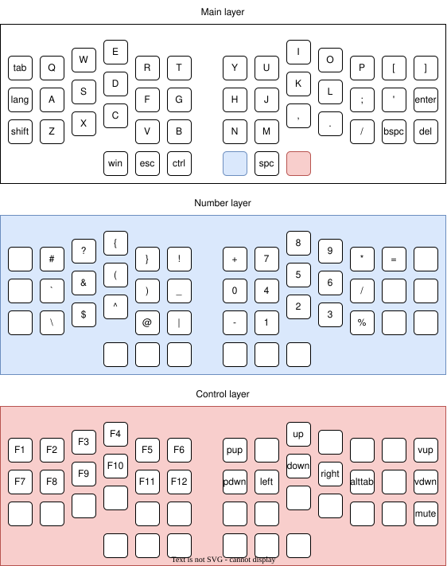

# PEPOTYPE

Handwired ortholinear column-staggered keyboard for full QWERTY/ЙЦУКЕН layout.

_there will be image soon_

## Materials

- 3D printable case and plate
- 10x M2x20 screws and nuts
- 45x MX-style switches
- 45x 1N4148 diodes
- 45x keycaps
- Single-core wire
- RP2040 Zero

## Software

QMK files are included.

## Layout

## Build Guide

_there will be a guide here soon_
